# Design: Mission Planner UI

## Overview

This redesign turns `apps/web` from a developer test panel into a problem-first Mission Planner for farmers and drone pilots. The page keeps every existing haunted visual (`BansheeDial`, `HauntedSkyPlot`, `StormGraveyard`, `WailAudio`) and adds:

- A `Hero` section with the cost-shock headline and two primary actions (Live / Replay May 2024).
- A Leaflet `FieldMap` (client-only) for picking a location by click, search, preset, or geolocation.
- A `MissionTypeSelector` and `DecisionCard` that turn the existing `RiskAssessment` into a plain-language `GO` / `CAUTION` / `HOLD` decision for the selected `Mission_Type`.
- A new `/api/forecast` endpoint and `SafeWindowTimeline` that project 12 hourly assessments from current telemetry and surface the best safe window.

All risk numbers continue to come from `assessFieldRisk()` in `@banshee/engine` — the UI and the new forecast route are both thin, honest callers of that function. `packages/engine` gains one new pure module (`forecast.ts`) for the hourly projection logic so it can be property-tested the same way `risk.ts` is; everything else in this design lives in `apps/web`.

The Urdu dictionary and any `dir="rtl"` handling are not present in the current code (`apps/web/src/lib/i18n.ts` is already English-only, and no `rtl`/`lang=` branching exists anywhere under `apps/web/src`), so Requirement 9 is satisfied by not introducing any such code rather than by deleting existing code.

## Architecture

```mermaid
graph TD
    subgraph "apps/web (client)"
        Hero[Hero]
        FieldMap["FieldMap (dynamic, ssr:false)"]
        Geocoder[PlaceSearch / Geocoder]
        UML[UseMyLocation]
        Presets[Presets]
        AdvCoord[AdvancedCoordinates]
        MTS[MissionTypeSelector]
        Timeline[SafeWindowTimeline]
        Dial[BansheeDial]
        Sky[HauntedSkyPlot]
        Grave[StormGraveyard]
        Wail[WailAudio]
        Card[DecisionCard]
        Page["page.tsx (state: location, missionType, mode, selectedHour, theme)"]
    end

    subgraph "apps/web (server)"
        AssessRoute["/api/assess"]
        ForecastRoute["/api/forecast"]
    end

    subgraph "packages/engine (pure, DOM-free)"
        AssessFn["assessFieldRisk()"]
        ForecastFn["projectForecastHours()"]
        Helpers["levelToDecision / bestSafeWindow / wrapLongitudeDeg / validateLatLon"]
    end

    subgraph "packages/feeds"
        Live["fetchLiveSolarWind / fetchLiveGloTec / fetchLiveKp / fetchLiveGnssElements"]
        Replays["STORM_REPLAYS"]
    end

    Nominatim["Nominatim (OSM)"]
    Tiles["Carto dark tiles / OSM light tiles"]

    Page --> Hero
    Page --> FieldMap
    Page --> Geocoder
    Page --> UML
    Page --> Presets
    Page --> AdvCoord
    Page --> MTS
    Page --> Timeline
    Page --> Dial
    Page --> Sky
    Page --> Grave
    Page --> Wail
    Page --> Card

    FieldMap --> Tiles
    Geocoder --> Nominatim

    Page --> AssessRoute
    Page --> ForecastRoute
    AssessRoute --> AssessFn
    AssessRoute --> Live
    AssessRoute --> Replays
    ForecastRoute --> ForecastFn
    ForecastRoute --> Live
    ForecastRoute --> Replays
    ForecastFn --> AssessFn
    Card --> Helpers
    Timeline --> Helpers
```



### Why `projectForecastHours` lives in `packages/engine`, not the route handler

The hourly projection (persist telemetry, re-propagate GNSS with SGP4, apply the post-sunset scintillation factor, call `assessFieldRisk` once per hour) is deterministic given its inputs — it has no I/O of its own once the four feeds and the base time are supplied. That makes it a pure function candidate, and `packages/engine` is the only package in this repo allowed to contain pure, PBT-covered, DOM-free business logic (per `packages/engine` steering: "100% DOM-free and side-effect-free so all physics and scoring invariants can be property-tested with `fast-check`").

Putting it in the Next.js route handler instead would mean:
- It could only be tested by mocking `NextRequest`/`NextResponse` and the live fetchers together — an integration test, not a property test — so Requirement 10.5 ("fast-check property tests for new hourly-projection logic") could not be satisfied by a clean unit.
- The route would duplicate orchestration logic that is conceptually identical to looping `assessFieldRisk` with varying time, which belongs next to `assessFieldRisk` itself.

So the design adds `packages/engine/src/forecast.ts` exporting a pure `projectForecastHours(input)` that takes the already-fetched telemetry (solar wind, GloTEC, Kp, GNSS elements, base time, location, preset) and returns 12 `RiskAssessment` values plus derived metadata (`bestSafeWindow`, per-hour `postSunsetActive`). `apps/web/src/app/api/forecast/route.ts` stays a thin adapter: it fetches the four feeds (reusing the exact same `fetchLive*` functions `/api/assess` already uses), resolves a replay via `STORM_REPLAYS` when `replay` is supplied, and calls `projectForecastHours()`. This mirrors how `/api/assess` is already a thin adapter over `assessFieldRisk()` in `apps/web/src/lib/assess.ts`.

### Research: Leaflet dynamic import and tile providers

Leaflet reads `window`/`document` at import time, so it cannot be imported at module scope in a file that participates in Next.js server rendering. The established pattern (documented in [react-leaflet's Next.js guidance](https://react-leaflet.js.org/docs/start-setup/) and the [Next.js dynamic import docs](https://nextjs.org/docs/app/building-your-application/optimizing/lazy-loading)) is `next/dynamic` with `{ ssr: false }`, which the component tree already needs per Requirement 2.2. `FieldMap.tsx` will be imported by `page.tsx` via:

```ts
const FieldMap = dynamic(() => import("@/components/FieldMap"), { ssr: false });
```

Tile providers (no API key required):
- Haunted Mode: CartoDB dark basemap, `https://{s}.basemaps.cartocdn.com/dark_all/{z}/{x}/{y}{r}.png`, attribution `&copy; <a href="https://www.openstreetmap.org/copyright">OpenStreetMap</a> contributors &copy; <a href="https://carto.com/attributions">CARTO</a>` per [CARTO basemap attribution requirements](https://github.com/CartoDB/basemap-styles).
- Field Mode: standard OSM tiles, `https://tile.openstreetmap.org/{z}/{x}/{y}.png`, attribution `&copy; <a href="https://www.openstreetmap.org/copyright">OpenStreetMap</a> contributors` per the [OSM tile usage policy](https://operations.osmfoundation.org/policies/tiles/).

Both attributions are rendered through Leaflet's built-in `attribution` control so they persist across pans/zooms and theme switches (Requirement 2.5).

### Research: Nominatim usage policy

The [Nominatim usage policy](https://operations.osmfoundation.org/policies/nominatim/) requires: maximum 1 request/second, a valid `User-Agent` or `Referer` identifying the application, no heavy/automated bulk use, and encourages result caching. Requirement 3 maps each clause directly:
- 3.3 (max 1 req/s) → a module-level timestamp gate in `Geocoder`'s fetch wrapper.
- 3.4 (identifying header) → `Referer` is set automatically by the browser for same-origin-initiated fetches to a third-party host in most browsers, but since that's not guaranteed, the request will go through `apps/web/src/app/api/geocode/route.ts`, a thin server-side proxy that sets `User-Agent: BansheeMissionPlanner/1.0 (contact: see docs/data-sources.md)` explicitly. Proxying server-side also avoids exposing browser-set headers that vary by client and keeps the rate limiter server-authoritative (one gate, not one per browser tab).
- 3.2/3.5/3.6/3.7 (debounce, cache, cancel, min length) → handled client-side in the `Geocoder` component before the proxy is ever called, per Data Models/Components below.

## Components and Interfaces

All new components live under `apps/web/src/components/` and `apps/web/src/app/api/`, following the existing flat component layout (`BansheeDial.tsx`, `HauntedSkyPlot.tsx`, etc. are not nested in subfolders).

### `Hero.tsx`

```ts
interface HeroProps {
  onCheckLive: () => void;
  onReplayDisaster: () => void;
  costFigureSourced: boolean; // from docs/data-sources.md lookup, see below
}
```
Renders the header line, the two buttons (Requirement 1.2–1.3), and an "unsourced estimate" marker next to the cost figure only if `costFigureSourced` is false, which would happen only if the source entry is ever removed (Requirement 1.9). `costFigureSourced` is a build-time constant read from a small checklist in `apps/web/src/lib/sources.ts` (`export const COST_FIGURE_SOURCED = true;`, because the $69.6M–$1.7B figure is sourced in `docs/data-sources.md`) rather than parsing `docs/data-sources.md` at runtime — the figure is static marketing copy (Requirement 1.10), not a feed-derived value, so there is nothing to fetch.

### `FieldMap.tsx` (client-only, default export for `next/dynamic`)

```ts
interface FieldMapProps {
  location: Location;
  onPick: (loc: Location) => void;
  fieldMode: boolean;
  presets: readonly PresetLocation[];
}
interface PresetLocation { id: string; label: string; latDeg: number; lonDeg: number; }
```
Wraps `react-leaflet`'s `MapContainer`/`TileLayer`/`Marker`. One `Marker` only — a new click replaces it (Requirement 2.6). Tile `url`/`attribution` switch on `fieldMode` as described above. `onPick` is called with the clicked `{lat, lng}` already passed through `wrapLongitudeDeg`/`validateLatLon` (see Data Models) before reaching `page.tsx`, so every path that can set `Location` (click, search, preset, geolocation, advanced-coordinates form) is normalized identically.

### `PlaceSearch.tsx` (Geocoder)

```ts
interface PlaceSearchProps {
  onSelect: (loc: Location) => void;
}
interface GeocodeResult { label: string; latDeg: number; lonDeg: number; }
```
Internal behavior (Requirement 3):
- Debounce: a 800 ms timer restarts on each keystroke; submission also happens immediately on Enter or the search button, bypassing the timer.
- Minimum length: trimmed input `< 3` chars never starts a timer or fetch.
- Cache: a `Map<string, GeocodeResult[]>` keyed by the trimmed, lower-cased search text, scoped to component state (cleared on remount) — "current session" per Requirement 3.5.
- Rate limit + cancel: a single in-flight `AbortController` per component instance; starting a new request aborts the previous one (Requirement 3.6) and only one request leaves the browser per 1-second window (Requirement 3.3), enforced in the server proxy described below as the authoritative gate.
- Errors: fetch failure, 8 s timeout (`AbortSignal.timeout(8000)`), or HTTP 429 → inline error message, previous `Location` untouched (Requirement 3.9). Empty result array → "no places found" (Requirement 3.8).
- Attribution: a fixed "© OpenStreetMap contributors" line rendered under the result list (Requirement 3.11).

### `apps/web/src/app/api/geocode/route.ts`

```ts
// GET /api/geocode?q=<text>
// -> GeocodeResult[] | { error: string }
```
Proxies `https://nominatim.openstreetmap.org/search?format=json&limit=5&q=<text>` with the explicit `User-Agent` header, enforces the 1 req/s gate with a module-level `lastRequestAtMs`, and maps Nominatim's `{lat, lon, display_name}` rows to `GeocodeResult`. Longitude/latitude from Nominatim are run through the same `wrapLongitudeDeg`/`validateLatLon` helpers before being returned, so a malformed upstream value can never reach the client unvalidated.

### `UseMyLocation.tsx`

A single button calling `navigator.geolocation.getCurrentPosition`. Success → `onLocate({latDeg, lonDeg})` (still passed through `validateLatLon`/`wrapLongitudeDeg` for defense in depth, though browser geolocation is already in-range). `PERMISSION_DENIED` → message plus a reminder that map click, search, and presets remain available (Requirement 2.15). `POSITION_UNAVAILABLE`/`TIMEOUT`/geolocation absent (`"geolocation" in navigator` false) → message naming the reason, previous `Location` unchanged (Requirement 2.16).

### `Presets.tsx`

Renders the three fixed presets from Requirement 2.8 as buttons:

```ts
const PRESET_LOCATIONS: PresetLocation[] = [
  { id: "multan-farm", label: "Multan Farm", latDeg: 30.1575, lonDeg: 71.5249 },
  { id: "iowa-corn-belt", label: "Iowa Corn Belt", latDeg: 41.878, lonDeg: -93.0977 },
  { id: "islamabad-drone-pad", label: "Islamabad Drone Pad", latDeg: 33.6844, lonDeg: 73.0479 },
];
```
(Iowa and Islamabad coordinates reuse the same values already present in `STORM_REPLAYS["gannon-2024"].defaultLatDeg/defaultLonDeg` and `STORM_REPLAYS["nov-2025"]`, so presets and existing replay defaults agree.)

### `AdvancedCoordinates.tsx`

A `<details>`/`<summary>` collapsible (collapsed by default — Requirement 2.10), containing the latitude/longitude number inputs that were previously always visible in `page.tsx`. On submit/blur, runs `validateLatLon` and shows the returned message inline on failure (Requirements 2.11–2.12); on success, wraps longitude via `wrapLongitudeDeg` before calling `onChange`.

### `MissionTypeSelector.tsx`

```ts
interface MissionTypeSelectorProps {
  value: PresetId; // "TRACTOR_RTK" | "SURVEY_DRONE"
  onChange: (id: "TRACTOR_RTK" | "SURVEY_DRONE") => void;
}
```
Two-option control (Requirement 6.6), defaulting to `"TRACTOR_RTK"` in `page.tsx` state. `CUSTOM` is not exposed in this selector — it remains an internal engine `PresetId` not reachable from the redesigned UI, since Requirement 6.6 only asks for the two mission types.

### `DecisionCard.tsx`

```ts
interface DecisionCardProps {
  assessment: RiskAssessment | null; // null only when the request itself failed
  missionType: "TRACTOR_RTK" | "SURVEY_DRONE";
  requestFailed: boolean;
}
```
Uses the new pure helper `levelToDecision(level: RiskLevel): Decision` (see Data Models) to choose the headline, color, and icon (Requirement 6.1–6.5), then looks up one fixed English sentence from a `ACTION_COPY[missionType][decision]` table for the recommendation line (Requirement 6.8). Below that: the `preset` line (elevation mask, gain — straight from `assessment.preset`, Requirement 6.9), `topReasons` with `formatReason` (reusing the existing `apps/web/src/lib/format.ts`), feed ages/sources from `assessment.feeds` (Requirement 6.10), the fixed heuristic disclaimer string (Requirement 6.11, reusing `assessment.disclaimer` which already carries this exact wording from `HONESTY_DISCLAIMER`), and the "regional ionosphere estimate" phrasing (Requirement 6.12, already the exact wording the engine uses in its `IONOSPHERE_TEC` driver label — the card does not re-describe TEC independently). When `requestFailed` is true or `assessment` is `null`, the card shows only "Status unknown — do not rely on this tool" and renders no Decision (Requirement 6.15).

### `SafeWindowTimeline.tsx`

```ts
interface SafeWindowTimelineProps {
  hours: ForecastHour[]; // from /api/forecast, length 12
  selectedHour: number; // 0..11
  onSelectHour: (hour: number) => void;
  isReplay: boolean;
}
```
Renders 12 bars (height ∝ `score`, color/label from `level`, Requirement 4.10), each bar a `<button>` with `aria-label` stating hour/score/level (Requirement 4.18) and reachable by `Tab`/`Enter`/`Space`. Local clock time per bar is computed client-side from the `Location`'s longitude using the same `localSolarHour`-style arithmetic already in `packages/engine/src/physics.ts` (via a thin re-export, see Data Models) — the API returns UTC `timestampIso` per hour and the component derives the displayed local label, so there is exactly one implementation of the local-time math (Requirement 4.11). Post-sunset hours get a visual marker (Requirement 4.12). The component calls the pure `bestSafeWindow(hours)` helper to decide what to highlight: a window → highlighted bars + "Best Safe Window: {start}–{end} ({duration}h)" banner (Requirement 4.15); no window → "No safe window in the next 12 hours" plus a "Lowest-risk hour (not safe)" marker on the minimum-score bar (Requirement 4.16). A fixed caption states "Heuristic projection from current conditions, not a measured prediction" (Requirement 4.6). While `isReplay` is true, the same component renders the replayed storm's 12 hours in place of the live projection, and `page.tsx` keeps the `REPLAY` badge mounted above it (Requirement 4.19).

### `page.tsx` state model

```ts
type Mode = "live" | "replay";
type Theme = "haunted" | "field";

interface PlannerState {
  location: Location;             // { latDeg: number; lonDeg: number; label?: string }
  missionType: "TRACTOR_RTK" | "SURVEY_DRONE";
  mode: Mode;
  replayId: StormReplayScenario["id"] | null; // set only when mode === "replay"
  selectedHour: number;           // 0..11, index into the current forecast
  theme: Theme;                   // "field" when Field_Mode is active, else "haunted"
}
```
`location`, `missionType`, and `mode`/`replayId` are the three independent inputs that drive both `/api/assess` (for the dial/card at `selectedHour`'s time) and `/api/forecast` (for the timeline). `selectedHour` resets to `0` whenever `location`, `missionType`, or `mode` changes, and changing `selectedHour` alone re-fetches only `/api/assess` pinned to that hour's timestamp (Requirement 3.17/8.1) rather than re-fetching the forecast. `theme` is a plain boolean-backed toggle identical to today's `fieldMode` state, renamed for clarity and threaded into `FieldMap` for tile selection (Requirement 8.7).

## Data Models

### `/api/forecast` contract

Request (`GET /api/forecast`), mirroring `/api/assess`'s existing query-string shape in `apps/web/src/lib/assess.ts`:

| Param | Type | Notes |
|---|---|---|
| `lat` | string (number) | Required for live mode; ignored (scenario default used) for replay. Missing → `DEFAULT_LAT`; present-but-blank/non-numeric → `NaN` (engine reports `INVALID_INPUT`), same contract as `/api/assess`. |
| `lon` | string (number) | Same rules as `lat`. Wrapped into `[-180, 180)` before assessment (Requirement 7.3). |
| `presetId` | `"TRACTOR_RTK" \| "SURVEY_DRONE"` | Defaults to `TRACTOR_RTK` via `resolvePreset`. |
| `replay` | `StormReplayScenario["id"]` (optional) | One of the `STORM_REPLAYS` keys; selects Replay_Mode. |

Response body:

```ts
interface ForecastResponse {
  hours: ForecastHour[];        // exactly 12, offsets +0h..+11h
  disclaimer: string;           // same HONESTY_DISCLAIMER text as /api/assess, plus the
                                 // "heuristic projection" framing (Requirement 4.6/7.4)
  feeds: FeedStatuses;          // age + source for the base time, shape from @banshee/engine
  bestSafeWindow: SafeWindow | null;
  isReplay: boolean;
  replayLabel?: string;
  replayArchiveIso?: string;
}

interface ForecastHour {
  hourOffset: number;           // 0..11
  timestampIso: string;         // base time + hourOffset hours, UTC
  assessment: RiskAssessment;   // full engine output for this hour, unmodified
  postSunsetActive: boolean;    // mirrors assessment.lowLatPostSunsetActive, kept explicit
                                 // for Requirement 4.5's "flag" wording
}

interface SafeWindow {
  startHourOffset: number;      // 0..11
  endHourOffset: number;        // startHourOffset..11, inclusive
  durationHours: number;        // endHourOffset - startHourOffset + 1
  meanScore: number;
}
```

HTTP 400 (Requirement 7.2) is returned with `{ error: string }` when `latDeg` is outside `[-90, 90]` or `lonDeg` is non-finite, checked by `validateLatLon` before any feed fetch — this avoids spending a Nominatim-adjacent or CelesTrak fetch budget on a request that cannot produce a valid assessment anyway. A failed feed fetch (any of the four) does not 500; it is passed to `projectForecastHours` as `null`, which (via the existing `listStaleFeeds`/`isFreshAge` machinery already in `risk.ts`) marks every hour `isStale: true` with level floored at `Uneasy`, never an empty or silently-`Safe` result (Requirement 7.5).

### `packages/engine/src/forecast.ts` (new pure module)

```ts
export interface ForecastInput {
  latDeg: number;
  lonDeg: number;
  baseTimestampIso: string;
  presetId?: PresetId | (string & {});
  elevationMaskDeg?: number;
  solarWind: SolarWindSample | null;
  glotec: GloTecGrid | null;
  kpIndex: number | null;
  gnssElements: GnssOmmElement[] | null;   // raw OMM elements; re-propagated per hour
  feedAges: FeedAgesMinutes;                // ages at baseTimestampIso
  isReplay?: boolean;
  replayLabel?: string;
  replayArchiveIso?: string;
}

export interface ForecastHourResult {
  hourOffset: number;
  timestampIso: string;
  assessment: RiskAssessment;
  postSunsetActive: boolean;
}

export interface ForecastResult {
  hours: ForecastHourResult[];   // length 12
  bestSafeWindow: SafeWindow | null;
}

export function projectForecastHours(input: ForecastInput): ForecastResult;
```

For each `hourOffset` in `0..11`: compute `timestampIso = addHoursIso(input.baseTimestampIso, hourOffset)`; call `propagateGnssElements(input.gnssElements ?? [], input.latDeg, input.lonDeg, timestampIso)` to get that hour's satellite geometry (Requirement 4.3); build a `RiskAssessmentInput` that holds `solarWind`/`glotec`/`kpIndex` constant but ages each feed by `+ hourOffset * 60` minutes relative to the ages supplied at the base time (Requirement 4.2, and this is exactly what makes Requirement 4.9's per-hour staleness possible — a feed fresh at +0h can become stale by +10h purely from the added age); call `assessFieldRisk()` once (Requirement 4.1). `postSunsetActive` is read straight off `assessment.lowLatPostSunsetActive`, which `assessFieldRisk` already computes from `isLowLatPostSunsetWindow(latDeg, lonDeg, timestampIso)` for the hour's own timestamp (Requirement 4.4). If the base `feedAges` indicate any feed is already stale at `+0h` (`listStaleFeeds` on the base input is non-empty), every one of the 12 calls inherits that same stale feed at an age that only grows, so every hour is floored at `Uneasy` by the existing `combineRiskDriversDetailed` stale floor — no separate "mark all 12 stale" branch is needed (Requirement 4.8 falls out of the per-hour aging rule for free). After all 12 assessments are built, `bestSafeWindow(hours.map(h => ({ level: h.assessment.level, score: h.assessment.score })))` is called once to produce `ForecastResult.bestSafeWindow`.

### Pure helper functions (new, placed for unit/property testing)

| Function | Package | Rationale for placement |
|---|---|---|
| `levelToDecision(level: RiskLevel): Decision` | `packages/engine/src/decision.ts` | Total, pure, 3-value mapping with no DOM dependency — belongs beside `scoreToLevel` in the engine so both halves of score→level→decision are PBT-covered in one package, and so `apps/web` never re-implements the Safe/Uneasy/Haunted semantics. |
| `bestSafeWindow(hours: { level: RiskLevel; score: number }[]): SafeWindow \| null` | `packages/engine/src/forecast.ts` | Operates only on the engine's own `RiskLevel`/`score` types; needed by both the route (to populate `ForecastResult.bestSafeWindow`) and the `SafeWindowTimeline` component (which re-derives the same value client-side after a per-hour click re-fetches `/api/assess` — keeping one implementation avoids the two ever disagreeing). |
| `wrapLongitudeDeg(lonDeg: number): number` | `packages/engine/src/physics.ts` (existing) | Already implemented and already exported from `@banshee/engine`'s public surface via `index.ts`; the UI and `/api/forecast`/`/api/assess` import it rather than re-implementing wrapping (Requirement 2.13, 7.3). |
| `validateLatLon(latDeg: unknown, lonDeg: unknown): LatLonValidation` | `apps/web/src/lib/validateLatLon.ts` (new) | Unlike `wrapLongitudeDeg`, this function's job is to produce UI-facing rejection *messages* ("Latitude must be a finite number between -90 and 90") per Requirement 2.11/2.12, which is presentation text, not physics — it belongs in `apps/web` and internally delegates range/finiteness checks to primitives, then calls `wrapLongitudeDeg` from `@banshee/engine` only after validation passes. This keeps `packages/engine` free of UI copy while still reusing the engine's own finite-number and range conventions (same bounds `assessFieldRisk`/`sanitizeInput` already enforce via `invalidFields`). |

```ts
// packages/engine/src/decision.ts
export type Decision = "GO" | "CAUTION" | "HOLD";
export function levelToDecision(level: RiskLevel): Decision {
  switch (level) {
    case "Safe": return "GO";
    case "Uneasy": return "CAUTION";
    case "Haunted": return "HOLD";
  }
}
```

```ts
// apps/web/src/lib/validateLatLon.ts
export interface LatLonValidation {
  ok: boolean;
  latDeg: number | null;   // set only when ok
  lonDeg: number | null;   // wrapped into [-180, 180), set only when ok
  message: string | null;  // set only when !ok, names the valid range
}
export function validateLatLon(latRaw: unknown, lonRaw: unknown): LatLonValidation;
```

### Query param → engine input mapping (shared by `/api/assess` and `/api/forecast`)

Both routes continue to use the existing `parseCoord`/`presetOptions` helpers in `apps/web/src/lib/assess.ts`; `/api/forecast`'s equivalent module (`apps/web/src/lib/forecast.ts`) imports them rather than duplicating the parsing, keeping the two routes' input handling identical by construction.

## Correctness Properties

*A property is a characteristic or behavior that should hold true across all valid executions of a system — essentially, a formal statement about what the system should do. Properties serve as the bridge between human-readable specifications and machine-verifiable correctness guarantees.*

### Property 1: Longitude wrap is always in range and idempotent

For all finite longitude values (including values far outside [-180, 180), negative zero, and values already inside the range), `wrapLongitudeDeg` returns a value in `[-180, 180)`, and applying `wrapLongitudeDeg` a second time to its own output returns the same value.

**Validates: Requirements 2.13, 7.3**

### Property 2: `validateLatLon` accepts exactly the valid domain

For all `(latRaw, lonRaw)` pairs drawn from finite numbers, non-finite numbers (`NaN`, `Infinity`), and non-numeric values (strings, `undefined`, objects): `validateLatLon` reports `ok: true` if and only if `latRaw` is a finite number in `[-90, 90]` and `lonRaw` is a finite number; whenever `ok` is `true`, the returned `lonDeg` equals `wrapLongitudeDeg(lonRaw)`; whenever `ok` is `false`, `message` names the applicable valid range.

**Validates: Requirements 2.11, 2.12, 2.13**

### Property 3: `bestSafeWindow` returns the longest Safe run with deterministic tie-breaking, or none

For all arrays of exactly 12 `{ level, score }` pairs: if at least one entry has `level === "Safe"`, `bestSafeWindow` returns a window that is a maximal consecutive run of `Safe` entries, its length is greater than or equal to the length of every other consecutive `Safe` run in the array, and when multiple runs share the maximum length, the returned window is the one with the lowest mean score, breaking any further tie by the earliest start index; if no entry has `level === "Safe"`, `bestSafeWindow` returns `null`.

**Validates: Requirements 4.13, 4.14, 4.16**

### Property 4: `levelToDecision` is total and order-preserving

For all three `RiskLevel` values, `levelToDecision` returns exactly one of `GO`, `CAUTION`, `HOLD` with no input producing `undefined` or throwing, and the mapping preserves severity order: `levelToDecision("Safe") = "GO"`, `levelToDecision("Uneasy") = "CAUTION"`, `levelToDecision("Haunted") = "HOLD"`, with no two distinct levels mapping to the same decision.

**Validates: Requirements 6.1**

### Property 5: Stale data never yields a GO decision

For all valid `RiskAssessmentInput` values where at least one required feed is stale (per the engine's own `listStaleFeeds`) or the request is otherwise flagged `isStale` by `assessFieldRisk`, `levelToDecision(assessFieldRisk(input).level)` is never `"GO"`.

**Validates: Requirements 6.14**

### Property 6: Hourly projection always returns 12 engine-produced assessments, and base staleness floors every hour

For all valid `ForecastInput` values, `projectForecastHours(input).hours` has exactly 12 entries, each entry's `assessment` is a value `assessFieldRisk` could have produced for that hour's own input (same score/level invariants as the engine's existing bounds property), and when the base input's feeds are stale at `hourOffset = 0`, every one of the 12 entries has `assessment.level !== "Safe"`.

**Validates: Requirements 4.1, 4.2, 4.8**

### Property 7: A feed aging past its limit by a given hour marks exactly that hour Stale

For all valid `ForecastInput` values where every feed is fresh at `hourOffset = 0`, and for all choices of a single feed and an hour offset `h` in `1..11` such that the feed's age at `+h` hours (base age plus `h * 60` minutes) exceeds that feed's `MAX_FEED_AGE_MINUTES` limit while its age at every offset `< h` does not, the resulting `ForecastHourResult` at offset `h` has `assessment.isStale === true` and `assessment.level !== "Safe"`, while every offset strictly before `h` is unaffected by that feed's aging.

**Validates: Requirements 4.9**

## Error Handling

| Failure | Where handled | User-visible behavior |
|---|---|---|
| Nominatim request fails, times out (8 s), or returns 429 | `PlaceSearch.tsx` catch block around the fetch to `/api/geocode` | Inline error message; previous `Location` kept (Requirement 3.9). |
| Nominatim returns zero results | `PlaceSearch.tsx` | "No places found" message (Requirement 3.8). |
| Geolocation permission denied | `UseMyLocation.tsx` `error.code === PERMISSION_DENIED` | Message plus reminder of map click/search/presets (Requirement 2.15). |
| Geolocation unavailable/timeout/other error | `UseMyLocation.tsx` | Message naming the reason; previous `Location` kept (Requirement 2.16). |
| Invalid latitude/longitude typed into Advanced Coordinates | `AdvancedCoordinates.tsx` via `validateLatLon` | Inline message naming the valid range; value not applied (Requirement 2.11/2.12). |
| `/api/forecast` or `/api/assess` request itself fails (network error, non-2xx, JSON parse failure) | `page.tsx` fetch wrapper | `DecisionCard` renders "Status unknown — do not rely on this tool"; no `GO` is shown (Requirement 6.15). |
| One or more of the four live feeds fails inside a route handler | `buildAssessResponse` / the new forecast equivalent, already handled by `settle()` in `apps/web/src/lib/assess.ts` | That feed is `null`, not a thrown error; `assessFieldRisk`/`projectForecastHours` mark the result(s) stale rather than returning 500 or a silently-`Safe` body (Requirement 7.5). |
| Invalid `lat`/`lon` query params on `/api/forecast` | Route handler, before any fetch | HTTP 400 with a descriptive `{ error }` body (Requirement 7.2). |
| Unknown `presetId` or invalid `elevationMaskDeg` | Already handled inside `resolvePreset` (existing engine code) | `unknownPresetReason`/`customMaskDefaultedReason` surfaced on the assessment exactly as today; no new handling needed. |
| No Safe hour anywhere in the 12-hour window | `SafeWindowTimeline.tsx` reading `bestSafeWindow === null` | "No safe window in the next 12 hours" plus "Lowest-risk hour (not safe)" marker (Requirement 4.16). |

## Testing Strategy

**Property-based tests** (new `packages/engine/tests/forecast.pbt.test.ts` and `packages/engine/tests/decision.pbt.test.ts`, following the existing `*.pbt.test.ts` naming convention already used for `engine.pbt.test.ts`/`grounding.pbt.test.ts`): use `fast-check` with `vitest`, matching the engine's existing devDependencies (`fast-check@^3.23.1`, `vitest@^2.1.8` already in `packages/engine/package.json`) — no new library is introduced. Each test runs a minimum of 100 iterations (`fc.assert(fc.property(...))` default is 100 runs, kept explicit where a smaller generator space would otherwise need `{ numRuns: 100 }`) and carries a comment tag:

```ts
// Feature: mission-planner-ui, Property 1: For all finite longitude values, wrapLongitudeDeg
// returns a value in [-180, 180) and is idempotent.
it("PBT (wrapLongitudeDeg): range and idempotence", () => { ... });
```

one such tagged test per property above (Properties 1–7), each implemented as a single `fc.assert` call per the workflow's "SINGLE property-based test per correctness property" rule. Property 1 reuses `wrapLongitudeDeg`, which already exists in `packages/engine/src/physics.ts` from the `bugfix-longitude-wrap` spec — this spec adds the property test for the Mission Planner's own reliance on it (Requirement 2.13/7.3) rather than re-deriving the function. `apps/web/src/lib/validateLatLon.ts`'s property test (Property 2) runs under `apps/web`'s own vitest setup; since `@banshee/engine`'s `fast-check` devDependency is only declared in `packages/engine/package.json`, `apps/web/package.json` adds `fast-check` as a devDependency for this one test file.

**Unit/example tests**:
- `DecisionCard`: one example per `(level, missionType)` combination (6 cases) asserting the exact headline strings from Requirements 6.2–6.4 and that the staleness warning (6.13) and feed-failure fallback (6.15) render their exact copy.
- `PlaceSearch`: fake-timer tests for the 800 ms debounce, a mocked-fetch test for cache-hit-skips-network, and an abort-signal test asserting the first request's controller is aborted when a second search starts.
- `/api/geocode` route: example tests for the 1 req/s gate (two rapid calls, second is delayed or the test asserts the gate function directly), the `User-Agent` header being set, and 429/timeout mapping to the error shape `PlaceSearch` expects.
- `/api/forecast` route: example tests for the HTTP 400 branch (bad lat/lon), the replay branch (matches `/api/assess`'s existing replay handling using the same `STORM_REPLAYS`), and a live-mode example with all four feeds mocked.
- `FieldMap`: a smoke-level render test asserting the correct tile `url`/`attribution` string is passed for each of `fieldMode = true/false`, since full Leaflet rendering is DOM/canvas-heavy and the provider-selection logic is the only non-trivial behavior to pin down here (everything else is react-leaflet's own tested behavior).
- Playwright (`apps/web/e2e/mission-planner.spec.ts`, extending the existing MapLibre-era smoke test carried over per the requirements change log): Hero buttons render and are clickable; activating Replay shows the `REPLAY` badge and archive timestamp; selecting a preset updates the `DecisionCard`'s headline; clicking a timeline bar changes `selectedHour` and updates the dial (Requirement 10.7).

This is a case where both PBT and example tests earn their place: the pure helpers (`wrapLongitudeDeg`, `validateLatLon`, `bestSafeWindow`, `levelToDecision`, `projectForecastHours`) have large or combinatorial input spaces where property tests find edge cases example tests would miss (a 12-length array of levels has thousands of meaningfully distinct shapes), while the UI copy/wiring requirements (exact headline text, debounce timing, badge visibility) are fixed strings and fixed interactions better pinned down by naming the expected example directly. No PBT is written for `FieldMap` tile selection, the Hero, or Playwright flows, since none of those express a "for all inputs" relationship — they are small, fixed-shape UI contracts.

**Quality gates** (Requirement 10): `npm run typecheck && npm test` and `npm --workspace=@banshee/web run build` must stay green; the new `packages/engine/src/forecast.ts` and `decision.ts` import no DOM/`window`/`document`/Leaflet symbols, keeping `packages/engine` DOM-free (Requirement 10.4); no API keys are introduced (Nominatim, OSM tiles, and Carto tiles are all keyless) (Requirement 10.6).
